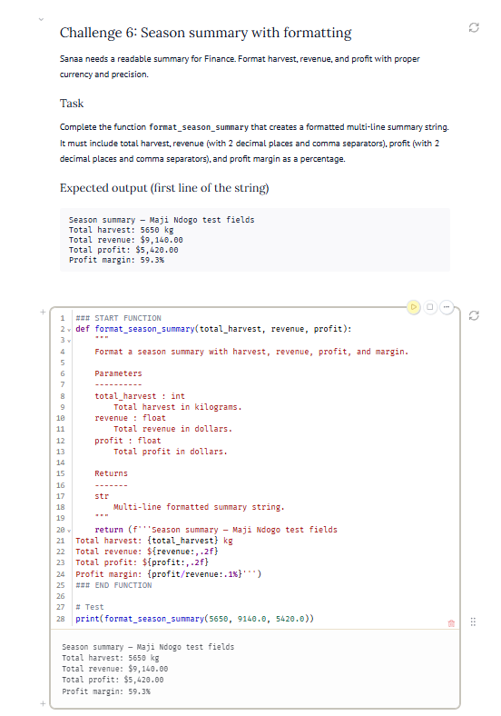
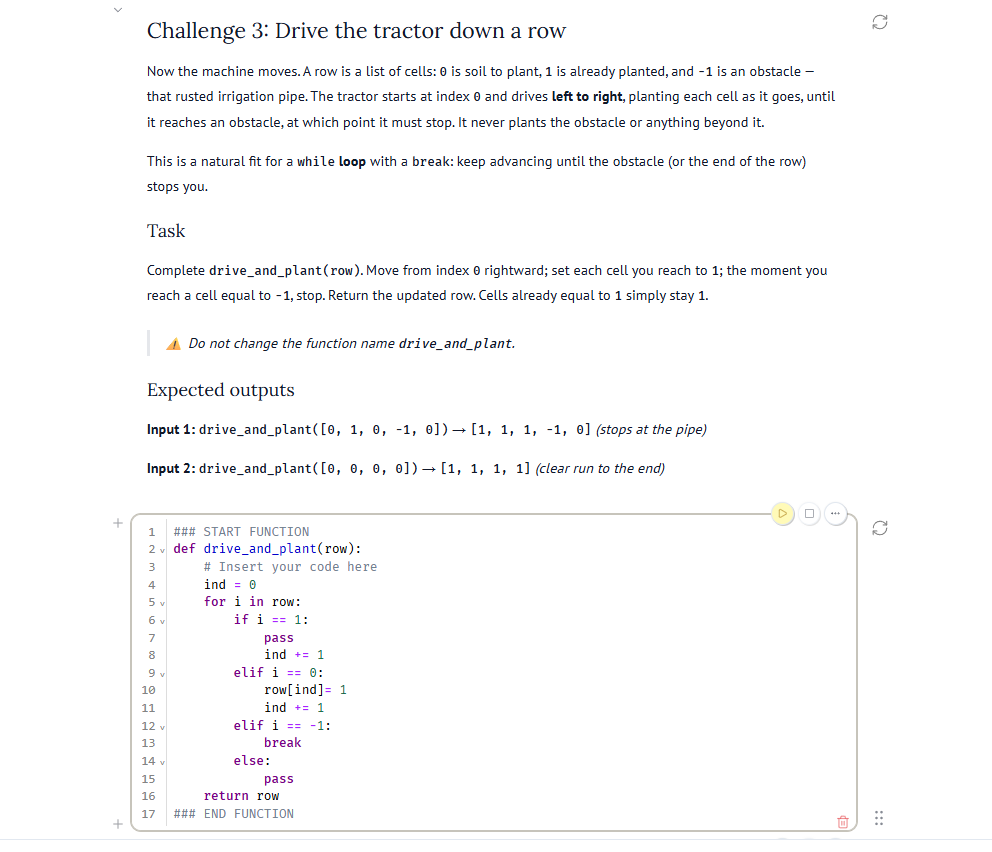
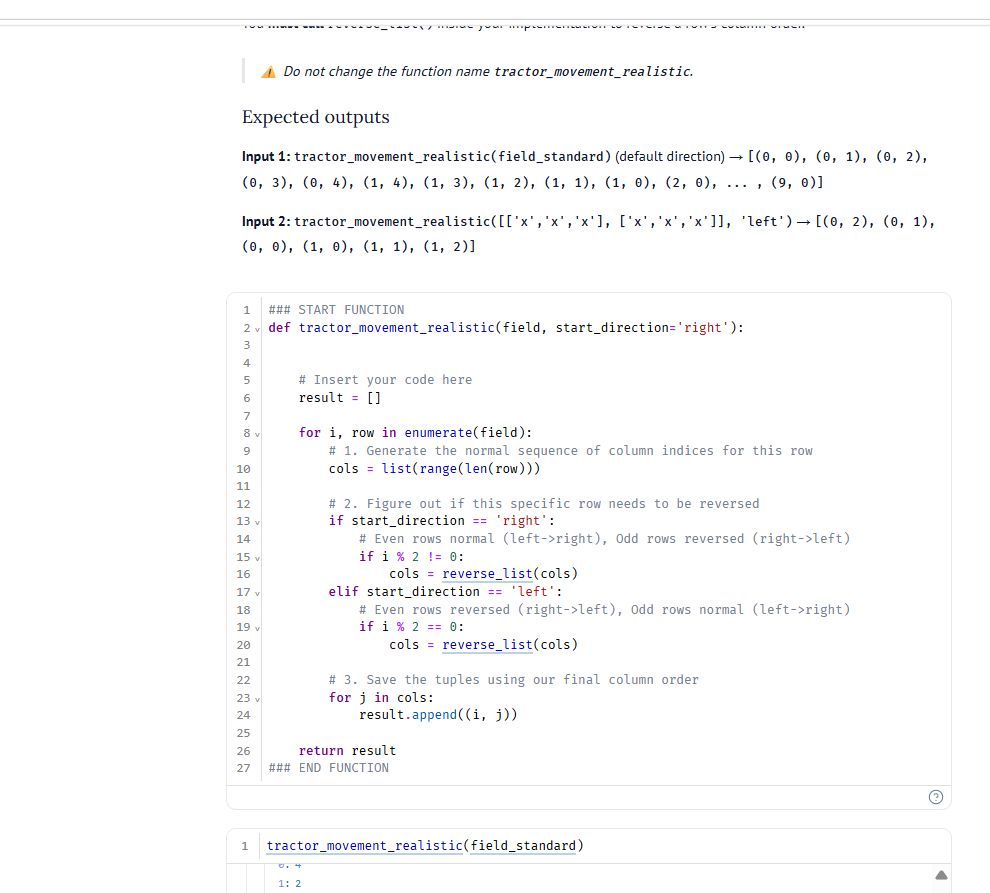

# Python Foundations: Maji Ndogo Digital Twin
**Author:** Hermon Tesfaye | Software Engineering (AI Track)

### The Business Problem
The Maji Ndogo Ministry of Agriculture faced a critical data and automation bottleneck. Farm records were scattered across handwritten notepads, and expensive tractor fleets were operating entirely manually, leading to wasted fuel and unpredictable crop yields[cite: 1, 2]. The ministry needed a foundational "Digital Twin"—a programmable logic layer to accurately record harvests, track equipment fuel states, and automatically route tractors through fields without human intervention[cite: 2, 3].

### The Tech Stack
**Core Python (No Libraries)**
Building this architecture without external libraries demonstrates a rigorous grasp of software engineering fundamentals. The logic relies purely on Python's built-in data structures (dictionaries, sets, lists, tuples), control flow (nested loops, conditionals), comprehensions, and modular function design (`*args`, `**kwargs`) to build lightweight, highly performant algorithms[cite: 1, 2, 3].

### The Deliverable

The transition from static records to an automated fleet required three distinct developmental phases:

**1. Financial and Harvest Data Integrity**
To replace the ministry's fragile notepad system, raw text data was cleaned and transformed into immutable tuples and dictionary records[cite: 1]. This execution processes raw harvest weights and market prices to output a strictly formatted, error-free financial summary for the ministry's finance team[cite: 1].

**2. Automated Obstacle Detection**
A farm cannot be automated if machines cannot respond to their physical environment[cite: 2]. This logic utilizes a loop to drive a tractor down a digital grid, halting movement the exact moment it detects an obstacle (represented by `-1`), preventing equipment damage and eliminating the need for manual oversight[cite: 2].

**3. Boustrophedon Path-Planning Algorithm**
To eliminate fuel waste from tractors driving back over their own paths, a modular path-planning algorithm was designed[cite: 3]. By utilizing a helper function to reverse lists, this boustrophedon sweep alternates the tractor's direction (left-to-right, then right-to-left) row by row, ensuring 100% field coverage with zero backtracking[cite: 3].

### The "So What?"
The ministry transitioned from guessing farm yields to managing a fully data-driven agricultural ecosystem. Financial reporting is now instant and accurate, while automated tractors cover fields efficiently without wasting fuel or hitting obstacles. This clean, structured data pipeline provides the exact foundation required to eventually train and deploy advanced artificial intelligence models for future crop yield predictions.
